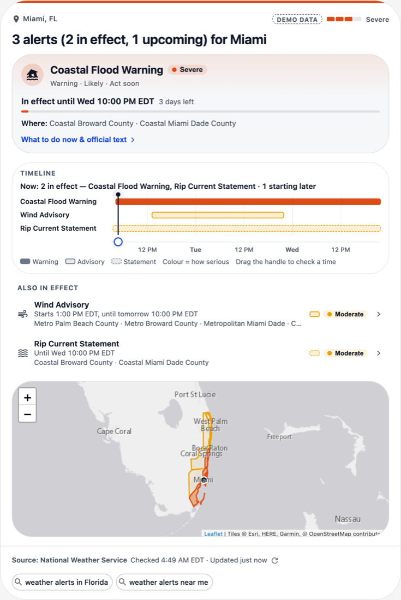
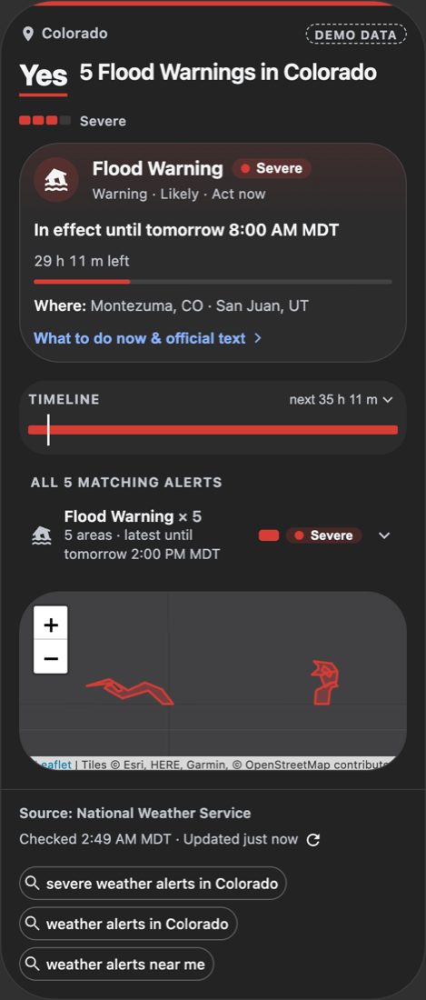
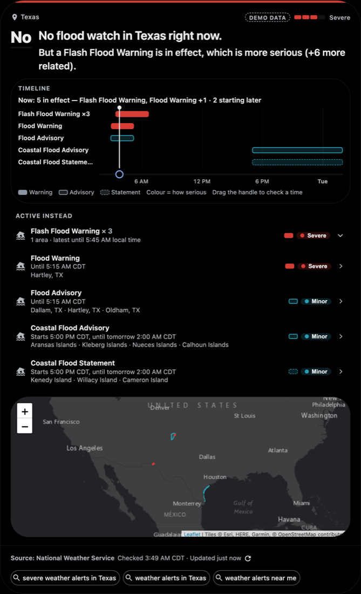
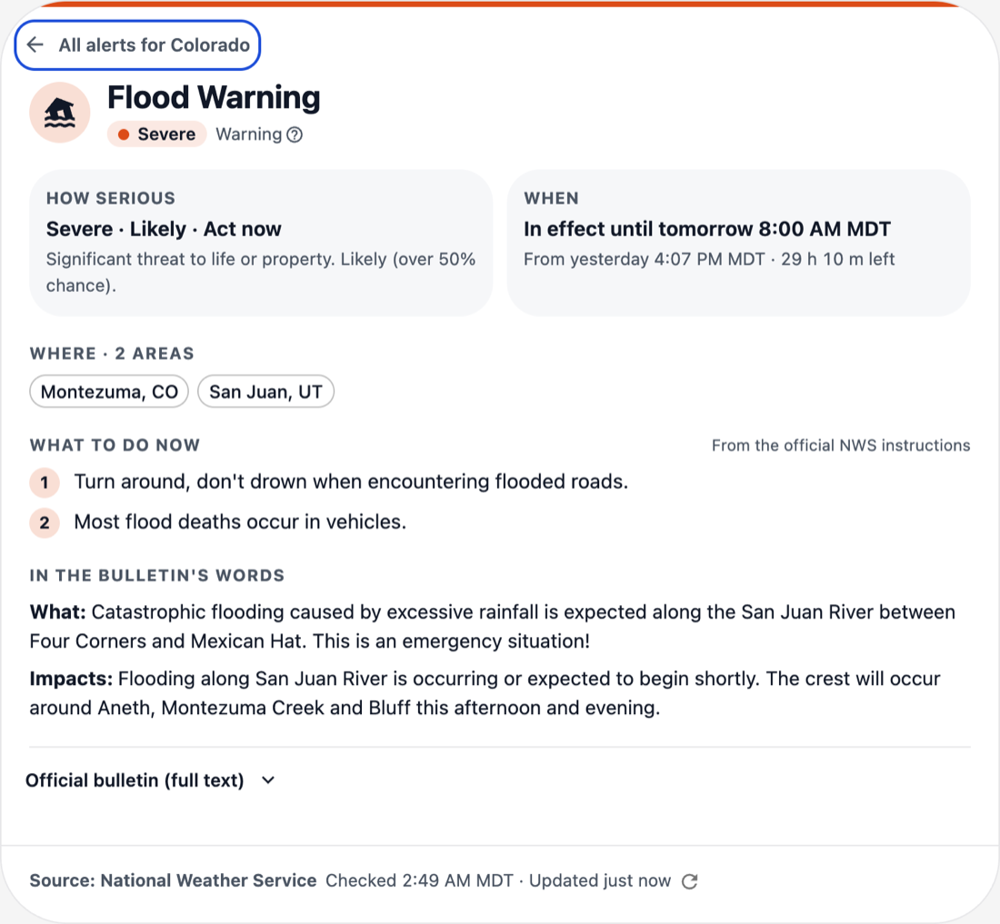
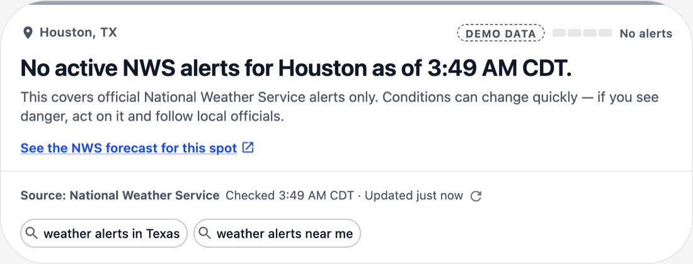
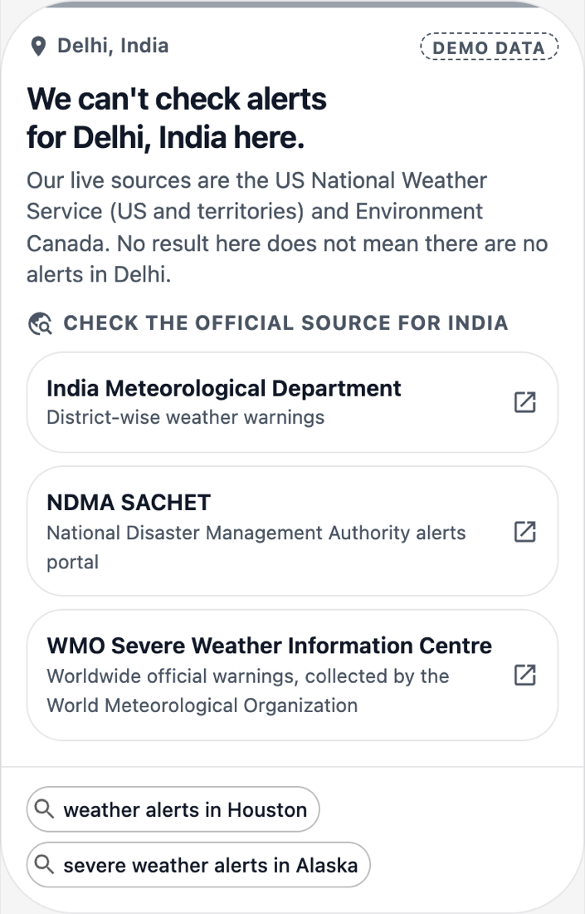
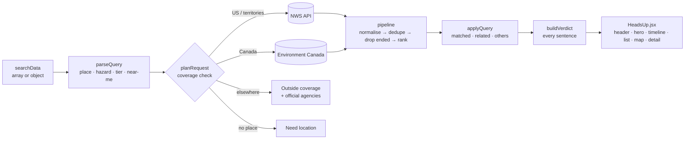

# HeadsUp — live disruption & safety alerts for hyperDart

**Search "weather alerts in Houston" and get the answer, not a bulletin:**
*is anything happening there right now, how serious is it, where exactly, and until when?*

HeadsUp is a standalone [hyperDart](https://hyperdart.com/docs/docs/intro) component. It answers in the first lines of the card, from official data only, and never implies that a place is safe. Everything else — timeline, map, what to do, the full official text — is one tap away.

| | |
|---|---|
|  |  |
|  |  |
|  |  |

*Screenshots use the sandbox demo mode (recorded live data, marked DEMO DATA). Live queries look the same without the badge.*

---

## How it answers the four questions

| Question | Where it is answered |
|---|---|
| **Is anything happening?** | The headline: "3 alerts (2 in effect, 1 upcoming) for Miami". Yes/no questions get a big **Yes** / **No** first. |
| **How serious?** | The colour strip along the top, a 4-step seriousness meter (Minor → Extreme) with its name in words, and the alert's own severity, certainty and urgency in plain words ("Severe · Likely · Act now"). |
| **Where exactly?** | The place line, the affected areas on the hero card, and a map of the official alert shapes. |
| **Until when?** | "In effect until 9:45 PM CDT · 2 h 10 m left", in the **place's** time zone, with a progress bar; "Until further notice" when the agency gave no end time. |

The six required example queries, as they behave:

| Query | Result |
|---|---|
| weather alerts in Houston | Active alerts for Houston, or "No active NWS alerts for Houston as of 2:47 AM CDT." plus the coverage caveat |
| flood warnings in Colorado | "**Yes** — 5 Flood Warnings in Colorado", grouped by event, with counties |
| severe weather alerts in Alaska | Only Severe/Extreme alerts, with "Show 14 less serious alerts" |
| is there a heat advisory in Phoenix | A direct **Yes** / **No**. If a more serious heat warning is active instead, it says so |
| weather alerts near me | Alerts at the searcher's location ("approximate" when based on IP), with a "Use my precise location" option |
| weather alerts in Delhi | "We can't check alerts for Delhi, India here" + India Meteorological Department and NDMA SACHET links |

## Design decisions

- **Verdict first.** The top ~120 px answer all four questions without scrolling. Everything else is progressive disclosure: hero card → timeline → list → map → detail → full official text.
- **Never stop at "No".** "No flood warnings in Colorado right now" is always followed, with the same visual weight, by "But 3 other alerts are active", or by "But an Extreme Heat Warning is in effect, which is more serious".
- **No false reassurance.** The words *safe*, *all clear* and *nothing to worry about* never appear (a unit test checks the verdict sentences for every state). "No alerts" uses a neutral grey, never a green check, and always carries the caveat "This covers official National Weather Service alerts only…". A failed request **never** shows "no alerts": it says "Couldn't reach the National Weather Service, so we can't confirm whether alerts are active."
- **`ends` vs `expires`.** "Until when" is the hazard's end (`ends`). `expires` is only when the *message* lapses (the agency may re-issue it), so it is shown separately, e.g. "This bulletin is valid until 3 PM; NWS may extend or update it."
- **Timeline ribbon (the signature interaction).** From 2 h ago to the latest end time (max 72 h): one bar per alert, colour = seriousness, pattern = kind (warning solid, watch striped, advisory outlined, statement dashed), so it reads without colour too. Drag the handle — or use ←/→, PageUp/PageDown, Home, End — to ask "what is in effect at 9 PM tonight?". The answer updates live in words. In the sidebar it collapses to a 28 px strip.
- **Own colour palette, validated.** Extreme magenta-crimson, Severe red-orange, Moderate amber, Minor blue-teal. Checked with a colour-vision-deficiency / contrast validator in light and dark. Colour is never the only signal: every coloured mark sits next to a text label or icon.
- **Official words only.** "What to do now" is the official instruction text split into sentences — nothing is rewritten or generated. Descriptions are split into their own "WHAT / WHERE / WHEN / IMPACTS" sections. The full bulletin and a link to the official record are one tap away.
- **Works everywhere it is embedded.** Sidebar (≤420 px) and mainline (≤720 px), `light`, `dark` and `lightsOut`, resizing via `ResizeObserver`, keyboard reachable, `aria-live` verdict, `prefers-reduced-motion` respected.

## Data sources

| Source | Used for |
|---|---|
| [NWS Alerts API](https://www.weather.gov/documentation/services-web-api) `api.weather.gov/alerts/active` (`point`, `area`, `severity`) | Live alerts for the US and its territories |
| NWS zone endpoints (`affectedZones`) | Map shapes for zone-based alerts (fetched lazily, cached, 4 at a time, max 25) |
| NWS `/alerts/types` | The official event names, embedded in `src/frontend/data/nwsEventTypes.js` |
| [Environment and Climate Change Canada — MSC GeoMet](https://api.weather.gc.ca/collections/weather-alerts) | Live alerts for Canada (stretch goal) |
| Official national agencies (`src/frontend/data/officialSources.js`) | Links for places outside live coverage. Every URL checked for HTTP 200 on 2026-10-26 |
| Esri World Light/Dark Gray Canvas tiles | Map basemap (© Esri, HERE, Garmin, © OpenStreetMap contributors; attribution shown) |

All requests go straight from the browser (both APIs send `Access-Control-Allow-Origin: *`). There is no backend and no API key.

## Libraries

React 19 · MUI 6 + Emotion (from the hyperDart React + Vite template) · Vite 6 · Leaflet 1.9 (loaded on demand) · Vitest 3. MUI icons for hazard symbols.

## Architecture



```
src/frontend/
  index.jsx              export default withHD(HeadsUp)
  HeadsUp.jsx            parse → plan → fetch → verdict → layout; componentLoaded once
  lib/                   pure JavaScript, no React — all the logic, unit-tested
    parseQuery.js        searchData → what was asked; planRequest = coverage decision
    nwsClient.js         fetch with 8 s timeout, one retry, 60 s cache, typed errors
    eccc.js              Environment Canada adapter (same alert shape)
    normalizeAlert.js    NWS feature → flat alert; status (upcoming / ending soon / ended)
    dedupe.js rank.js group.js filterHazard.js pipeline.js
    verdict.js           all user-facing sentences
    time.js              place-local times, "in 2 h 10 m"
    bulletin.js          splits official text without changing a word
    hazards.js           ALL hazard knowledge (one entry per hazard)
    states.js sources.js zones.js host.js
  components/            VerdictHeader, AlertHero, TimelineRibbon, AlertList, AlertDetail,
                         MapSlot + AlertMap, States, SourceLine, FollowUpChips, Severity
  hooks/                 useAlerts (fetch + auto-refresh), useNow, useElementWidth, useDemoFixture
  theme/                 makeTheme (light / dark / lightsOut), severity palette and wording
  data/                  officialSources.js, nwsEventTypes.js
  demo/fixtureMode.js    sandbox-only demo data (removed from the production build)
fixtures/                recorded API responses + real hyperDart searchData
```

## Run, test, build

```bash
npm install
npm start          # sandbox at http://localhost:5173 — type queries in its search bar
npm test           # 79 unit tests (Vitest)
npm run build      # dist/frontend/index.modern.js (+ the Leaflet chunk)
```

**Demo mode (sandbox only).** Quiet days happen. Open the sandbox with `?fixture=<name>` to replay a recorded response; times are shifted to "now" and the card shows **DEMO DATA**. It only works in the dev sandbox: the production build removes it (`import.meta.env.DEV`), and it also requires `UIOptions.sandbox`.

| `?fixture=` | Shows |
|---|---|
| `miami`, `daytona` | several alerts for a city |
| `colorado-flood`, `alaska-severe`, `texas`, `florida`, `national` | state / national views |
| `texas-flood-watch` | "No — but a more serious Flash Flood Warning is in effect" |
| `phoenix-heat`, `sanjuan-heat` | yes / no heat advisory |
| `houston-empty`, `houston-error` | no alerts; NWS failure |
| `delhi`, `san-juan-ambiguous`, `near-me-in` | outside coverage |
| `near-me-us`, `near-me-unknown`, `tornado-near-me` | near me (IP, none, the "Tornado, WV" trap) |
| `quebec`, `toronto-empty` | Environment Canada |
| `zip`, `no-location`, `object-shape` | edge cases |

## How to extend (live-review recipe)

**Add a hazard** — one entry in `src/frontend/lib/hazards.js`:

```js
volcano: { label: 'Volcano', synonyms: ['volcano', 'volcanic'], eventMatch: /volcano/i, icon: 'WarningAmber' },
```

The query words, the event filter ("Volcano Warning"), the icon and the "No volcano warnings — but…" wording all follow. To make such queries trigger the component, also add the word to a regex in `hyperdart.config.js`. A new icon name must be added to `components/HazardIcon.jsx`.

**Add a query pattern** — one string in `query_format.regex` in `hyperdart.config.js`, for example:

```js
'(weather\\s+)?(alerts?|warnings?)\\s+(today|tonight)\\s+(in|for)\\s+HD_LOCATION(__\\w+)?.*',
```

Then add a test in `src/frontend/lib/parseQuery.test.js` and try the query in the sandbox search bar.

**Add a country's official link** — one entry in `src/frontend/data/officialSources.js`.

## Edge cases handled

- `searchData` as an array (sandbox) or a single object (production).
- "tornado warning near me": the NLU returns the town **Tornado, WV** — near-me wording wins and hazard-word entities are ignored. Hazard words inside place names ("Storm Lake") are ignored too.
- ZIP codes arrive without coordinates → "We couldn't pin down 77002" + a "weather alerts in Houston" chip.
- "San Juan" resolving to Argentina → the answer names the country, so the mix-up is visible.
- Non-US `stateAbb` values ("07", "ENG") are never treated as US states.
- Superseded updates, cancellations and duplicate VTEC messages are removed; alerts whose `ends` has passed are dropped.
- Upcoming alerts: "Starts 9:00 AM AST, until 5:00 PM AST", never shown as already active.
- Open-ended alerts: "until further notice", plus the message expiry.
- An alert on another time zone than the place (El Paso in a Texas query) keeps its own offset ("local time").
- Hazard words are matched precisely: "hurricane warning" does not count a Tropical Storm Warning as **Yes** (it is offered as related).
- National view: severe/extreme only, counted by state; marine alerts reported separately.
- Coverage is decided before any request (no call for Delhi); an NWS "out of bounds" reply is also treated as outside coverage, never as "no alerts".
- 8 s timeout, one retry on network errors / 5xx / 429; a failed *refresh* keeps the last result with a visible notice.
- Auto-refresh every 120 s only while the page is visible; countdowns tick every minute.
- The map loads only when scrolled into view and removes itself if tiles, shapes or the Leaflet chunk fail. The core component is a single file, so it works even if the host serves nothing else.
- Geolocation blocked in the iframe → keeps the IP result with a short note.

## Limitations

- Live coverage is the US and its territories (NWS) and Canada (Environment Canada). Other countries get an honest outside-coverage answer with official links.
- IP-based location is approximate. A *device* location has no country attached, so it is checked against the NWS only; outside the US it gets the outside-coverage answer.
- Environment Canada has no CAP severity. Its official risk colour is mapped to the seriousness scale (yellow → Moderate, orange → Severe, red → Extreme), and the colour, impact and confidence are always shown as published.
- When the NWS or Environment Canada is down, HeadsUp can only say it couldn't check.
- The Esri basemap tiles are used without a key, with attribution. Check Esri's terms of use before relying on them for heavy production traffic.

## How it was built (AI tools and authorship)

- The author wrote the build brief ([docs/BUILD_SPEC.md](docs/BUILD_SPEC.md)): the requirements analysis, UX states and wording rules, the design direction (verdict-first card, timeline ribbon, severity strip), the data rules (`ends` vs `expires`, coverage check) and the build order.
- The code, tests, fixtures and this README were produced with **Claude Code** (Anthropic, model Claude Opus 5.5) following that brief. Its log of what was checked against the live APIs and the template is in §16 of the brief.
- **What the author wrote or changed personally:** _TODO (author): describe your own edits, decisions and reviews here before submitting — the judges ask for this to be specific and honest._

## Links

- GitHub: _TODO_ (also set `github` in `hyperdart.config.js`)
- Demo video: _TODO_ (also set `demovideo` in `hyperdart.config.js`)
- Registry package: _TODO_
- Problem statement: [docs/Live_Disruption_Safety_Alerts_Problem_Statement.pdf](docs/Live_Disruption_Safety_Alerts_Problem_Statement.pdf)
